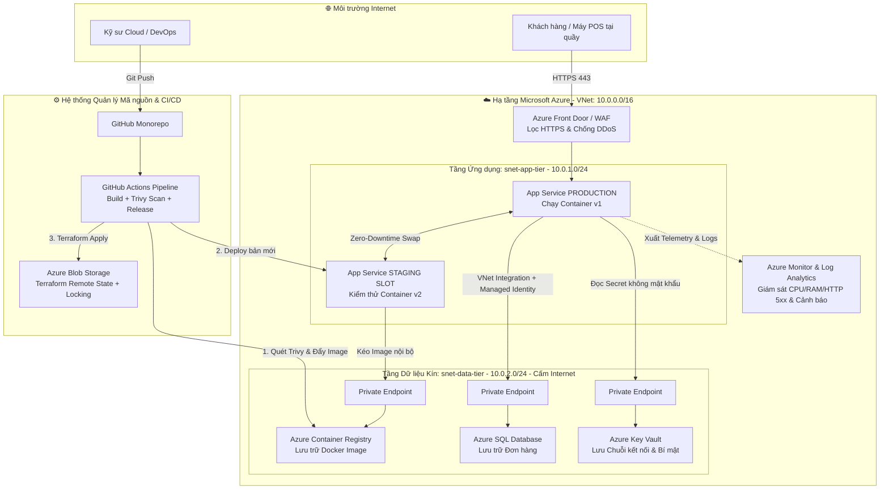

# 🏢 OmniPOS Enterprise — Cloud-Native Order & Inventory Platform


## 1. Tổng quan Dự án (Executive Summary)
**OmniPOS Enterprise** là dự án hạ tầng đám mây và dây chuyền DevSecOps hoàn chỉnh cho hệ thống Backend Quản lý Đơn hàng & Tồn kho (POS). Dự án giải quyết 4 bài toán sống còn của doanh nghiệp bán lẻ:
* **Zero-Downtime Deployment:** Triển khai phiên bản mới vào giờ cao điểm không gây gián đoạn giao dịch tại quầy (Blue-Green Deployment qua Azure App Service Slots).
* **Zero-Trust Network & Passwordless:** Cô lập hoàn toàn Database, Key Vault và Container Registry trong mạng nội bộ thông qua **Private Endpoints**. Loại bỏ 100% mật khẩu tĩnh bằng **Managed Identity (RBAC)**.
* **Reproducible Infrastructure (IaC):** Toàn bộ hạ tầng được mô đun hóa bằng **Terraform**, quản lý trạng thái tập trung trên Azure Blob Storage có cơ chế khóa chống xung đột (State Locking).
* **Shift-Left Security (DevSecOps):** Tự động quét lỗ hổng bảo mật Container Image bằng **Trivy** và bắt buộc phê duyệt thủ công (Manual Approval) trước khi đưa lên Production.

---

## 2. Kiến trúc Hệ thống (System Architecture)



---

## 3. Đặc tả Kỹ thuật & Tiêu chuẩn Bảo mật (Technical Specifications)

| Phân lớp (Layer) | Công nghệ sử dụng | Thiết kế Bảo mật & Tối ưu (Enterprise Best Practices) |
| :--- | :--- | :--- |
| **Infrastructure as Code** | Terraform (`azurerm` v4.x) | Chia 4 module độc lập (`networking`, `security_data`, `compute`, `monitoring`). Lưu State từ xa kèm cơ chế Lease Locking. |
| **Mạng & Tường lửa** | Azure VNet, NSG, Private DNS | Phân tách `snet-app-tier` và `snet-data-tier`. NSG chặn toàn bộ truy cập Internet trực tiếp vào tầng dữ liệu. |
| **Containerization** | Docker (Node.js 18 Alpine) | Áp dụng Layer Caching, loại bỏ gói thừa, ép dung lượng Image **< 50MB**, chạy dưới quyền `non-root user` (`node`). |
| **Xác thực & Định danh** | Azure Managed Identity | App Service kéo Image từ ACR qua quyền `AcrPull` và đọc Key Vault qua `Key Vault Secrets User` (Không dùng mật khẩu Admin). |
| **CI/CD Pipeline** | GitHub Actions, Trivy | Luồng tự động: `Checkout` $\rightarrow$ `Docker Build` $\rightarrow$ `Trivy Vulnerability Scan` $\rightarrow$ `Push ACR` $\rightarrow$ `Deploy Staging` $\rightarrow$ `Manual Approval` $\rightarrow$ `Swap Production`. |
| **Observability** | Azure Monitor, Log Analytics | Tích hợp endpoint `/healthz` tự động khởi động lại container bị treo (Auto-Healing) và báo động khi lỗi HTTP 5xx vượt ngưỡng. |

---

## 4. Cấu trúc Thư mục (Repository Structure)

```text
omnipos-enterprise/
├── README.md                        # Tài liệu Kiến trúc & Hướng dẫn Vận hành (Runbook)
├── .gitignore                       # Chặn đẩy file nhạy cảm (.tfstate, .env) lên Git
├── scripts/
│   ├── bootstrap-backend.ps1        # Khởi tạo ổ chứa Terraform Remote State
│   └── teardown-all.ps1             # Thu hồi toàn bộ hạ tầng về 0 đồng (FinOps)
├── infra/                           # Mã nguồn Hạ tầng (Terraform Modules)
│   ├── providers.tf                 # Cấu hình Azure Provider & Backend
│   ├── variables.tf                 # Biến đầu vào của hệ thống
│   ├── main.tf                      # Luồng lắp ghép các Module
│   ├── outputs.tf                   # Xuất thông tin Endpoint sau triển khai
│   └── modules/
│       ├── networking/              # VNet, Subnets, NSG, Private DNS Zones
│       ├── security_data/           # ACR, SQL DB, Key Vault, Private Endpoints
│       ├── compute/                 # App Service Plan, Web App, Staging Slot, Identity
│       └── monitoring/              # Log Analytics, Application Insights, Metric Alerts
├── src/                             # Mã nguồn Ứng dụng Microservice
│   ├── Dockerfile                   # Cấu hình đóng gói Image chuẩn bảo mật
│   ├── .dockerignore                # Loại bỏ thư mục rác khi build Docker
│   ├── package.json                 # Khai báo thư viện phụ thuộc
│   └── app.js                       # API Đơn hàng kèm cổng kiểm tra sức khỏe (/healthz)
└── .github/workflows/
    └── deploy-production.yml        # Đường ống CI/CD tự động hóa đa môi trường
```

---

## 5. Quy trình Triển khai Chuẩn (Operational Runbook)

### Bước 5.1: Khởi tạo Kho lưu trữ Trạng thái (Chạy 1 lần duy nhất)
```powershell
./scripts/bootstrap-backend.ps1
```

### Bước 5.2: Dựng Hạ tầng Đám mây bằng Terraform
```powershell
cd infra
terraform init
terraform plan -out=tfplan
terraform apply tfplan
```

### Bước 5.3: Vận hành CI/CD & Phê duyệt Phát hành
1. Đẩy mã nguồn mới lên nhánh `main` để kích hoạt GitHub Actions.
2. Kiểm tra báo cáo quét lỗ hổng bảo mật của **Trivy** trên tab Actions.
3. Truy cập URL của **Staging Slot** để nghiệm thu tính năng mới.
4. Bấm **Approve** trên GitHub Actions để hệ thống tự động tráo đổi (Swap) Staging sang Production không gián đoạn.

### Bước 5.4: Thu hồi Hạ tầng & Tối ưu Chi phí (FinOps Teardown)
Khi kết thúc ca thử nghiệm, chạy lệnh thu hồi để tài khoản không phát sinh chi phí:
```powershell
./scripts/teardown-all.ps1
```

---

## 6. Nhật ký Xử lý Sự cố Thực tế (Troubleshooting Log)
* **Sự cố 1 — Pipeline báo lỗi `exit code 3` ở bước CD:**
  * *Nguyên nhân:* Sai lệch tên Resource Group giữa bước khởi tạo hạ tầng và biến cấu hình trong GitHub Actions workflow.
  * *Khắc phục:* Truy vết Console Log của job `deploy`, đồng bộ hóa biến môi trường `RESOURCE_GROUP` trên toàn bộ pipeline.
* **Sự cố 2 — Lỗi mất kết nối Terraform State sau khi dọn dẹp tài nguyên:**
  * *Nguyên nhân:* Xóa nhầm Resource Group chứa Storage Account lưu trữ file `.tfstate`.
  * *Khắc phục:* Tách biệt Resource Group quản trị (`rg-omnipos-tfstate`) khỏi Resource Group chứa hạ tầng ứng dụng (`rg-omnipos-prod`) và tái đồng bộ bằng lệnh `terraform init -reconfigure`.